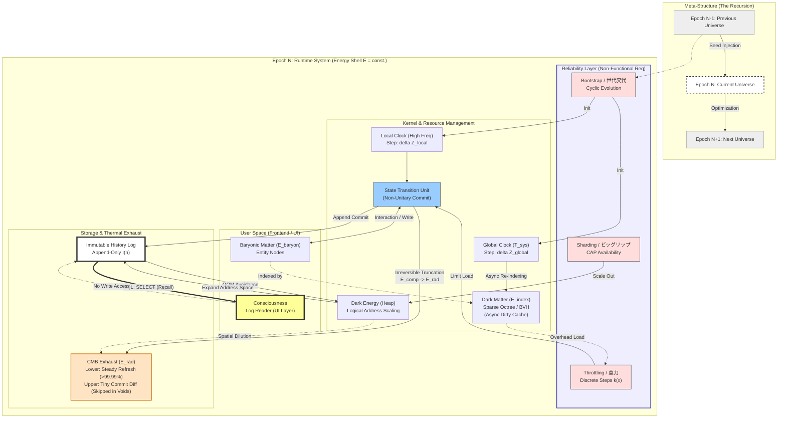

# Digital Cosmology Vol.3: System Architecture & Dark Sector
## 不可視領域（Dark Sector）におけるメタデータ管理・動的スケーリング・非ユニタリ排熱

**Date:** 2026-11-25
**Author:** Sevenforest (Concept Architect)
**Dependency:** Vol.1, Vol.2, Kernel_01 (v2.0), Kernel_02, Kernel_03 (v2.0), Kernel_04 (v2.0)

---

### 概要 (Abstract)
本稿は、デジタル宇宙論（Digital Cosmology）の第3巻として、宇宙の約95%を占めるとされる「ダークマター（暗黒物質）」および「ダークエネルギー（暗黒エネルギー）」、ならびに全天から観測される「宇宙背景放射（CMB）」の正体を、計算機システムのアーキテクチャ視点から定義する。
既存の物理学において正体不明とされてきたダークセクターは、有限のリソースで稼働する離散状態遷移システムを維持するための **「疎な空間分割インデックス（Metadata）」** および **「論理アドレス空間の動的拡張（Dynamic Heap Scaling）」** である。さらにCMBは、**「下位レイヤーによる基底排熱の定常リフレッシュと、上位レイヤーにおける不可逆Commitの微小イベント排熱の2層構造」** として統一的に記述される。

---

### 1. 序論：95%のオーバーヘッド
現代の標準宇宙論（$\Lambda$-CDMモデル）において、我々が電磁波で直接知覚できる通常の物質（バリオン）は宇宙全体のわずか約5%に過ぎず、残りの約95%はダークマター（約27%）とダークエネルギー（約68%）に割り当てられている。

システム工学の視点において、総構成の95%が「用途不明の謎物質・謎エネルギー」であるという説明は異常である。しかしこれを、**「ユーザーデータ（5%）を管理・格納・運用するためのシステム管理構造（空間インデックスと論理アドレス枠の拡張）」** として捉え直せば、大規模分散データベースとして極めて合理的な設計構造が浮かび上がる。

---

### 2. 重力の再定義：計算負荷としての質量
先行研究（`Vol.1` / `Kernel_02`）において、時間は「状態更新のステップ数」、重力は「局所的な処理遅延」と定義された。

#### 2.1 質量とCPUスロットリング
システムにおいて「質量を持つ」とは、そのオブジェクトが物理演算（当たり判定、位置更新、相互作用）の対象として計算コストを要求することを意味する。

$$\text{Mass } M \propto \text{Computational Complexity（計算負荷）}$$
$$\text{Gravity} \propto \text{Processing Lag（CPUスロットリング）}$$

演算密度 $T_{\mu\nu}$ が高い領域では計算リクエストが集中し、システムは過負荷を防ぐため局所クロックを段階的に低下させる（スロットリング）。`Kernel_03` (2章) の通り、このスロットリング制御は離散的な段数 $k(x)$（刻み $\delta Z_{\text{local}}$）で行われるため、同一段数内では重力赤方偏移の「不感帯（Dead Zone）」が生じる。

---

### 3. ダークマター：疎な空間分割インデックス（Sparse Octree / BVH）
「光（電磁波）とは相互作用しないが、重力（負荷）は持つ」とされるダークマターの正体は、未知の素粒子ではなく、宇宙OSが広大なアドレス空間上のオブジェクトを管理するために維持している **「疎な空間分割インデックス（Sparse Octree / BVH 等の階層ツリー構造）」の計算オーバーヘッド** である（`Kernel_03` 4章）。

※なお、初期ドラフトで検討された全ノード総当たりモデル（$O(N^2)$）は、高密度の太陽系や銀河中心部ほどダークマター比率が爆発する観測矛盾を生むため、v2.0 において正式に廃止された。

#### 3.1 コリジョンメッシュと階層空間インデックス
3D物理演算エンジンにおいて、表示用の高精細モデルとは別に、当たり判定や空間検索を高速化するための階層構造（Octree / BVH / コリジョンメッシュ）がバックエンドに構築される。

* **通常物質（$M_{\text{baryon}}$ / 約5%）:** 電磁相互作用を通じてUI層へレンダリングされる「実体ノードデータ」。
* **ダークマター（$M_{\text{index}}$ / 約27%）:** 描画（発光・吸収）はされないが、オブジェクト同士の空間配置と相互作用検索を維持するために計算セクタ予算（$E_{\text{comp}} = E_{\text{baryon}} + E_{\text{index}}$）を消費し続ける **「空間分割インデックス構造」**。計算コストを消費する以上、外部からは重力源（処理遅延）として観測される。

#### 3.2 Sparse Optimization（疎最適化）と密度逆転の帰結
宇宙OSは計算リソースを節約するため、階層インデックスに **Sparse Optimization（疎最適化）** を採用している。この単一仕様から、密度の異なる3領域の観測事実が矛盾なく導かれる。

1.  **完全な空洞領域（ボイド / Null Zone）:** オブジェクトが存在しない領域では、**上位レイヤー（空間分割ツリーおよびオブジェクト管理）のみが未割り当て（Null）かつ処理スキップ**となる。したがってボイドのインデックスコストはゼロ（$M_{\text{index}} = 0$）となり、ダークマターは存在しない（なお下位レイヤーの基底CMB循環自体は停止しない：4.3節）。
2.  **高密度・局所領域（太陽系・銀河中心部）:** 物質が同一の最小区画（リーフ）に密集しているため、上位ツリーの維持コストは物質本体のコスト $M_{\text{baryon}}$ に対して無視できるほど小さい（バリオン支配）。
3.  **低密度・広域領域（銀河外縁部・矮小銀河）:** 物質が希薄であっても、散在するオブジェクトを広大なアドレス空間に繋ぎ止めるための階層ツリー維持コストは発生する。結果として外縁部ほど **$M_{\text{index}} / M_{\text{baryon}}$ の比率が跳ね上がり**、銀河の平坦な回転曲線が自然に再現される。

#### 3.3 非同期再構築と Dirty Cache（`Kernel_04` との接続）
空間分割インデックス $M_{\text{index}}$ の大域的な再構築（Re-indexing）は、低周波のグローバルクロック（$T_{\text{sys}}$：`Kernel_04`）に従って非同期実行される。そのため、銀河・銀河団の高速衝突や急激な大規模質量移動の発生から **$T_{\text{sys}}$（近似換算約326万年）以内の過渡的フェーズ** においては、バリオンの移動に対して空間インデックスの再配置が追いつかず、一時的に **Dirty Cache（更新待ちの空間インデックス）** として実体分布からズレた位置に重力源が取り残される（※複数回のグローバル再構築を完了した衝突後長時間の系は、Dirty Cache ではなく定常的な空間インデックス分布の問題として扱う）。

---

### 4. ダークエネルギーと非ユニタリ排熱（ヒープ拡張・CMB）

#### 4.1 変更不能なログ（Immutable Log）
デジタル宇宙において、過去とは「物理的に確定（Commit）した因果ログ」である。因果律を維持するため、確定済みログは追記（Append）のみが許可され、削除はされない。したがって、因果ステップ $n$ が進むほど保存すべき総記録量 $I(n)$ は単調に増大し続ける（`Kernel_03` 1.1節）。

#### 4.2 ダークエネルギー：論理アドレス空間の動的拡張（Dynamic Heap Allocation）
宇宙空間の「広がり」とは、システムが管理可能な **「論理メモリアドレス空間（Heap）」** の容量そのものである。

* **ダークエネルギーの正体:** 確定ログ $I(n)$ の増大に伴うメモリ不足（OOM）を回避するため、システムが書き込み可能なアドレス空間のスケール $R(n) \propto I(n)^\alpha$ を動的に拡張し続けているプロセス。
* **総エネルギー保存との両立:** これは物理エネルギーを無から創造する現象ではなく、論理的なアドレス枠（座標空間）の増設であるため、`Kernel_01` の総エネルギー殻保存 $E = \text{const.}$ を破らない。標準理論が宇宙エネルギーの約68%をダークエネルギーと計上しているのは、このアドレス空間拡張速度を連続時空上の「真空エネルギー密度」へと誤換算した結果である。

#### 4.3 排熱処理：2層CMB排熱アーキテクチャと Cold Spot (Thermal Management & Non-Unitary Exhaust)
本システム（v2.0）は、旧版の「厳密なユニタリ性によるスクランブル」仮説を廃止し、**「宇宙の基本遷移においてユニタリティ（微視的可逆性）は本質的に破れている」** という公理（`Kernel_01` 3章）を採用する。

* **エネルギー殻閉包による保存則:** 遷移ルールは多対一（不可逆な履歴切り捨て）を許容するが、系全体の総リソース $E$ は厳密に保存される。
  $$E = (E_{\text{baryon}} + E_{\text{index}}) + E_{\text{rad}} = \text{const.}$$
* **2層排熱アーキテクチャ（CMBの正体）:** 背景セクタ $E_{\text{rad}}$（宇宙背景放射：CMB）は、役割の異なる2つの階層で維持される（`Kernel_01` 3.2節 / `Vol.2` 2.3節）。
  1. **下位レイヤー（時空カーネルの基底維持）：** 質量の有無に関わらず全天で均一に稼働し、すでに $E_{\text{rad}}$ に存在する基底エネルギーを毎ステップ再シャッフル（熱平衡リフレッシュ）し続ける。新規エネルギーを生み出さないため $E = \text{const.}$ を厳守し、全天の99.99%超を占める均一な 2.725K 黒体放射のベースラインを維持する。
  2. **上位レイヤー（オブジェクト管理・相互作用Commit）：** 物質が存在する領域およびその影響圏で稼働し、イベント確定（Commit）時の未確定パス切り捨てに伴う極微小な端数エネルギー（基底に対して $10^{-5}$ オーダーの差分）を、イベント駆動で $E_{\text{comp}} \to E_{\text{rad}}$ へ転送する。この上乗せ分は基底背景に対してごく微小であるため、銀河団が強烈なCMB光源になる矛盾を起こさず、かつ4.2節のヒープ拡張による空間希釈と釣り合うことで熱暴走も回避される。
* **CMB Cold Spot の桁感との整合:** 巨大な超空洞（ボイド）では3.2節の **Sparse Optimization** により上位レイヤーのみが未割り当て（Null）・処理スキップとなる。下位レイヤーの基底循環自体は全天で稼働し続けているため、ボイドは真っ暗な穴にはならず、上位レイヤー由来の極微小な排熱差分だけが欠落することで、平均温度からわずかに凹む **CMB Cold Spot（約 $-0.005\%$）** が生じる。

---

### 5. 偏移（Shift）の再定義：通信レイテンシの総和
ハッブルの法則に代表される赤方偏移は、宇宙が物理的に遠ざかっているドップラー効果ではなく、情報が到達するまでの「トータル・同期レイテンシ」の指標である（`Kernel_03` 3章）。

$$Z_{\text{total}} = Z_{\text{base}}(d) + Z_{\text{load}}(T_{\mu\nu}) + Z_{\text{move}}(v)$$

1.  **基本ラグ（$Z_{\text{base}}$）:** 空間ブロックのホップ数 $m$ に応じた基底同期コスト。グローバルクロック刻み $\delta Z_{\text{global}}$（`Kernel_04`）により離散化し、Tifftの赤方偏移量子化を生む。
2.  **負荷ラグ（$Z_{\text{load}}$）:** 局所的な演算密度 $T_{\mu\nu}$ によるスロットリング遅延。定常的な重力赤方偏移（$\delta Z_{\text{local}}$ 刻みの不感帯）に加え、クエーサーや高密度成熟銀河（JWST観測等）の強烈な演算負荷による異常赤方偏移（アープ効果）を統一的に説明する。
3.  **移動ラグ（$Z_{\text{move}}$）:** オブジェクトの移動に伴う通信ホップ数の増減。接近によりホップ数が短縮されると $Z_{\text{move}} < 0$ となり、アンドロメダ銀河等の青方偏移が生じる。

---

### 6. 結論：有限リソースシステムの最適解
本論（v2.0）により、宇宙のシステムアーキテクチャは以下の通り矛盾なく統一された。

| Component | Physical Name | System Role (v2.0 Unified Spec) |
| :--- | :--- | :--- |
| **Frontend (UI)** | Baryonic Matter (~5%) | Render target / entity nodes ($E_{\text{baryon}}$). |
| **Spatial Index** | Dark Matter (~27%) | Sparse Octree / BVH maintenance overhead ($E_{\text{index}}$); async update delay manifests as Dirty Cache. |
| **Heap / Address** | Dark Energy (~68% apparent) | Dynamic logical address space scaling for immutable logs (no violation of $E = \text{const.}$). |
| **Thermal Exhaust** | CMB ($E_{\text{rad}}$) | Two-layer exhaust: Lower-layer steady baseline refresh (>99.99%) + Upper-layer tiny event-driven Commit differential ($10^{-5}$ order); upper layer skipped in Null Voids (Cold Spot). |
| **Latency** | Gravity / Redshift | Quantized CPU throttling ($\delta Z_{\text{local}}$) & global sync latency ($\delta Z_{\text{global}}$). |

